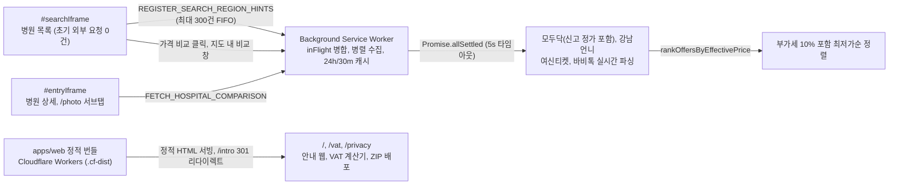

<p align="center">
  <h1 align="center">medi-bridge</h1>
  <p align="center">네이버 지도에서 병원별 다중 플랫폼 비급여 가격을 모아 최저가순으로 정렬해 주는 Chrome 확장 프로그램</p>
  <p align="center"><a href="https://medi-bridge.seungwoo7050.workers.dev">medi-bridge.seungwoo7050.workers.dev</a></p>
  <p align="center">Chrome Extension (MV3) | WXT | React 19 | Next.js 16 | TypeScript | Zod | Cloudflare Workers | Playwright</p>
</p>


네이버 지도에서 치과, 안과, 피부과, 성형외과, 정형외과를 찾을 때 병원 이름을 복사해서 여러 앱을 번갈아 검색할 필요 없이, 지도 화면 안에서 모두닥, 강남언니, 여신티켓, 바비톡의 이벤트 가격과 병원 신고 정가를 한 번에 모아서 부가세 10% 포함 실결제 금액 순으로 비교합니다. 검색 목록의 `가격 비교` 버튼을 눌러도 특정 사이트로 바로 이동하지 않고 지도 안에 비교 창을 먼저 열어 주며, 원하는 시술 가격을 눌렀을 때만 해당 플랫폼으로 연결합니다.

> 비공식 브라우저 확장 도구입니다. 네이버, 모두닥, 강남언니, 여신티켓, 바비톡, 굿닥이 운영하거나 제휴한 서비스가 아닙니다.

## 주요 기능

| 화면 | 돕는 일 |
| --- | --- |
| **검색 목록 비교 패널** | 지도 왼쪽 검색 목록(광고 행 포함) 옆 `가격 비교` 버튼을 누르면 외부 탭으로 나가지 않고 지도 안에서 플랫폼별 최저가순 가격, 시술 탭 필터, 부가세 포함 토글을 보여줍니다 |
| **병원 상세 및 사진 탭 카드** | 병원 상세(`/home`)나 사진(`/photo`) 탭을 열면 수집된 전체 플랫폼 가격표를 최저가 오름차순으로 상단에 띄웁니다 |
| **툴바 팝업** | 확장 프로그램 사용 여부를 켜고 끄며 최근 확인한 병원 최대 20건의 최저가 플랫폼 요약과 네이버 지도 빠른 검색을 엽니다 |
| **안내 웹 및 부가세 계산기** | 실제 작동 화면과 지원 진료과 안내(`/`), 참고용 부가세 10% 계산기(`/vat`), 개인정보처리방침(`/privacy`)을 확인하고 체험 패키지 ZIP을 내려받습니다 |

- 검색 목록이 열릴 때는 외부 사이트에 자동 조회 요청을 보내지 않고(0건), 사용자가 병원을 열거나 `가격 비교`를 누른 병원만 조회합니다.
- 회원가입, 로그인 쿠키, 별도 크롤링 백엔드 서버 없이 사용자 브라우저 내부에서만 동작합니다.
- `storage` 권한과 필수 7개 공개 도메인(`map.naver.com`, `pcmap.place.naver.com`, `www.modoodoc.com`, `unni.app`, `www.gangnamunni.com`, `api.yeoshin.co.kr`, `web-api.babitalk.com`) 외의 권한은 요구하지 않습니다.
- 최근 열람 이력과 단기 캐시는 모두 사용자 브라우저의 `chrome.storage.local`에만 저장합니다.

<p align="center"></p>

## 아키텍처와 핵심 설계



### 1. 별도 서버 없이 4개 플랫폼 가격을 동시에 모으는 방식

목록에서 `가격 비교`를 누르면 특정 플랫폼 새 탭으로 바로 이동하던 기존 방식을 버리고, `#searchIframe` 안에 Shadow DOM 패널([apps/extension/src/components/MediBridgeCompareDrawer.tsx](apps/extension/src/components/MediBridgeCompareDrawer.tsx))을 열도록 바꿨습니다. [apps/extension/src/entrypoints/background.ts](apps/extension/src/entrypoints/background.ts)의 서비스 워커가 진료과에 맞춰 대상 플랫폼을 `Promise.allSettled`(각 5초 타임아웃)로 한꺼번에 조회하고, 결과는 [packages/parsers](packages/parsers/src/index.ts)의 4개 파서가 각 사이트 공개 HTML(`__NEXT_DATA__`)과 JSON 응답에서 뽑아냅니다. 실제 새 탭 이동은 사용자가 목록에서 특정 플랫폼 시술 행을 직접 클릭했을 때만 실행합니다.

### 2. 부가세 10% 합산 정렬과 동명이원 구분

플랫폼마다 어떤 곳은 부가세를 포함해 적고 어떤 곳은 이벤트 가격만 먼저 노출한 뒤 `VAT 별도`를 작게 적습니다. [packages/shared/src/vatNormalizer.ts](packages/shared/src/vatNormalizer.ts)의 `rankOffersByEffectivePrice`가 별도 표기 상품에 10%를 가산해 실결제 금액 오름차순으로 줄 세우고, 상단 스위치로 표기가 기준 정렬과 즉시 비교할 수 있게 했습니다. 무료 검진이나 `0원` 상담 항목은 유료 시술 뒤로 내려 최저가 1위 자리를 덮지 않게 처리했습니다.

동명이원 오매칭을 막기 위해 [packages/shared/src/hospitalMatcher.ts](packages/shared/src/hospitalMatcher.ts)의 `scoreNameMatch`와 `evaluateRegionCompatibility`로 시/도와 시/군/구가 맞지 않는 후보는 버립니다. 네트워크 오류나 HTML 구조가 깨진 응답(`parse_error`), 지역이 비어 있을 때의 미일치(`not_found`)는 캐시에 저장하지 않아 뒤이어 들어온 정상 조회가 막히지 않게 했습니다.

### 3. 네이버 지도 다중 iframe 구조와 사진 탭 주소 전달

네이버 지도는 왼쪽 검색 목록(`#searchIframe`)과 오른쪽 병원 상세(`/home`, `/photo` 등이 열리는 `#entryIframe`)가 서로 다른 문서로 분리되어 있습니다. 목록 썸네일을 눌러 `/photo` 탭으로 들어가면 상세 문서에서 주소와 진료과 요소가 빠지기 때문에, 목록 문서([apps/extension/src/entrypoints/naver-place.content/index.tsx](apps/extension/src/entrypoints/naver-place.content/index.tsx))에서 먼저 뽑아 둔 `시/구` 정보를 서비스 워커의 FIFO 맵(`MAX_SEARCH_REGION_HINTS = 300`)에 보관했다가 상세 탭 조회에 이어 붙입니다. 모든 주입 UI는 WXT `createShadowRootUi`와 `:host { all: initial }`, `px` 고정 치수로 감싸 호스트 CSS의 `rem` 스케일 변경이나 스타일 간섭을 피합니다.

### 4. 로컬 저장소 쓰기 순서 보장과 정적 안내 웹

Content Script, 팝업, 서비스 워커가 동시에 `chrome.storage.local`을 읽고 덮어쓰면 최근 본 병원 목록이 유실될 수 있어서 [apps/extension/src/domain/bridgeStorage.ts](apps/extension/src/domain/bridgeStorage.ts)의 `enqueueWrite` FIFO 큐로 쓰기 작업을 한 줄로 세웠습니다. 안내 웹(`apps/web`)은 Next.js 정적 빌드 산출물과 확장 ZIP 패키지를 [apps/web/scripts/build-cf-bundle.mjs](apps/web/scripts/build-cf-bundle.mjs)로 조립해 Cloudflare Workers Static Assets에 올립니다.

## 프로젝트 구성

- **Chrome MV3 확장 (`apps/extension`)**: WXT, React 19, TypeScript, Shadow DOM 오버레이, 지도 내 비교 패널 및 툴바 팝업
- **정적 안내 웹 (`apps/web`)**: Next.js 16, React 19, Tailwind CSS v4, 공식 소개(`/`), 부가세 계산기(`/vat`), 개인정보처리방침(`/privacy`), 확장 ZIP 배포
- **공용 패키지 (`packages/*`)**: 상호·지역 매칭 및 부가세 10% 최저가 정렬(`shared`), 4개 플랫폼 파서와 오프라인 픽스처(`parsers`), 디자인 토큰(`ui`)
- **검증 및 CI (`.github/workflows/ci.yml`)**: TypeScript, Biome, Vitest, Chrome MV3 및 정적 웹 Playwright E2E

```text
medi-bridge/
├── .github/workflows/ci.yml   PR과 main 푸시 정적 검사, 빌드, 권한 검사, E2E 워크플로
├── apps/extension/            WXT Chrome MV3 확장 (Content Script, Background SW, Popup, E2E)
├── apps/web/                  정적 안내 웹, 부가세 계산기, 개인정보처리방침, Cloudflare Worker
├── packages/shared/           상호명과 지역 매칭, 부가세 10% 정렬과 포맷, 플랫폼 URL 빌더
├── packages/parsers/          모두닥, 강남언니, 여신티켓, 바비톡 파서 및 오프라인 픽스처 테스트
├── packages/ui/               공용 색상 토큰 및 SVG 아이콘
└── assets/                    네이버 지도 실제 적용 캡처 이미지
```

## 로컬 실행 및 검증

Node.js 22 이상과 `pnpm` 12 환경이 필요합니다.

```bash
pnpm install
pnpm build
pnpm zip:ext
```

Chrome에서 로컬 확장 프로그램을 불러와 확인하는 순서입니다.

1. 주소창에 `chrome://extensions`를 입력하고 우측 상단 **개발자 모드**를 켭니다.
2. **압축해제된 확장 프로그램을 로드합니다**를 눌러 `apps/extension/output/chrome-mv3` 폴더를 선택합니다.
3. [네이버 지도](https://map.naver.com)에서 치과, 안과, 피부과, 성형외과, 정형외과 병원을 검색해 목록 옆 `가격 비교` 버튼과 상세 및 사진 탭 카드를 확인합니다.

| 명령 | 설명 |
| --- | --- |
| `pnpm verify` | 5개 워크스페이스 타입 체크, Biome 린트와 포맷 검사, Vitest 단위 테스트 실행 |
| `pnpm build` | 확장(`output/chrome-mv3`)과 Next.js 안내 웹 전체 빌드 |
| `pnpm zip:ext` | Chrome Web Store 및 안내 웹 배포용 ZIP 패키지(`apps/extension/output/`) 생성 |
| `pnpm test:e2e` | 빌드된 Chrome MV3 확장(지도 내 비교 패널, 다중 플랫폼 최저가 정렬, `/photo` 릴레이 포함)과 정적 웹 Playwright E2E 실행 |
| `pnpm --filter @medi-bridge/web run deploy:cf` | `.cf-dist` 정적 번들을 조립해 Cloudflare Workers에 배포 |

CI 파이프라인([`.github/workflows/ci.yml`](.github/workflows/ci.yml))은 모든 Pull Request와 `main` 푸시에서 `pnpm verify`, 확장·정적 웹 빌드, `manifest.json` 최소 권한 검사, Playwright E2E를 순서대로 실행합니다. `main` 푸시 시 저장소 시크릿 `CLOUDFLARE_API_TOKEN`이 등록되어 있으면 `.cf-dist`를 Cloudflare Workers로 자동 배포합니다.

## 범위와 한계

- **굿닥과 `/photo` 직접 진입 범위**: 굿닥 상세 페이지 비급여 표는 클라이언트 렌더링 구조라 직접 파싱하지 않고 진료과에 맞는 병원 검색 링크(`goodoc.co.kr/hospitals?keyword=`)로 연결합니다. 검색 목록을 거치지 않고 `/hospital/<id>/photo` 주소로 바로 들어가면 중계된 지역 힌트가 없어 90점 이상 완전 또는 정규 일치 상호만 매칭합니다.
- **외부 사이트 구조 의존성**: 네이버 지도의 난독화 CSS 클래스나 각 플랫폼 공개 페이지 초기 데이터(`__NEXT_DATA__`) 및 API 응답 필드가 바뀌면 [naverEntryDom.ts](apps/extension/src/adapters/naverEntryDom.ts), [naverSearchListDom.ts](apps/extension/src/adapters/naverSearchListDom.ts), [packages/parsers](packages/parsers/src/index.ts)의 셀렉터와 파서를 함께 갱신해야 합니다.
- **스토어 심사 진행 상태**: Chrome Web Store 등록 심사 전에는 안내 웹(`/`)과 GitHub 저장소에서 체험용 ZIP 파일을 내려받아 개발자 모드로 로드해 사용합니다.
